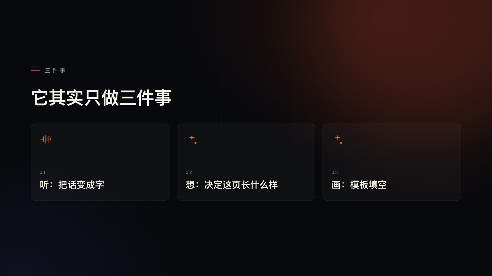

# Live Deck — slides that grow while you talk

You speak, and the slide grows with you.

Local streaming speech-to-text → a tiny LLM decides, on the spot, what this sentence should look like → a template renderer draws it immediately. Keep talking and the same page keeps getting refined. No script, no "generate 20 slides first", no waiting for the sentence to end.


---

## The problem

People who talk for a living — livestreams, internal training, product demos — have the same annoyance: **the content is spoken, but the visuals were laid out in advance.** Either spend three hours building a deck, or flip through pages that never quite match what you're saying.

Live Deck flips the order: you talk first, the visuals follow.

- Say "from three hours down to one minute" and a before/after comparison appears.
- Say three parallel points and three cards drop in, one after another.
- Say "the hard part is pacing" and you get one big line over a faint background glyph.
- Misspeak or backtrack and nothing jumps — every update inside a sentence rewrites the page in place.

The point: **pages grow one at a time instead of being generated all at once; the latency hides inside the second while you're still talking.**

| | |
| --- | --- |
|  |  |
|  |  |

## Run it

```bash
git clone https://github.com/wwq0327/live-deck && cd live-deck
node server.mjs            # open http://127.0.0.1:4400
```

No frontend build, no dependencies — plain `node`. Transcription needs a Python environment and a model; see "Models" below.


| Action | Effect |
| --- | --- |
| Click **麦克风** (or press `m`) | grant the mic, start talking, pause and the page appears |
| Type in the box + `Enter` | same pipeline, no microphone needed |
| **演示** (or `d`) | runs a 9-line sample script |
| Drop a `.wav` onto the page | replays a recording through the exact same pipeline |
| `r` / `f` / `h` | reset / fullscreen / hide the UI |

### Models

Two backends, chosen with `ASR_BACKEND`:

**A. SenseVoice (default, recommended).** ~50–140 ms per sentence on a laptop CPU.

```bash
python3 -m venv .venv && .venv/bin/pip install -r requirements.txt

# put the ONNX model here (int8 ≈ 239 MB)
#   ./models/sensevoice-onnx/model.int8.onnx
#   ./models/sensevoice-onnx/tokens.txt
# or point SENSEVOICE_DIR at wherever you kept it
```

Model: [`csukuangfj/sherpa-onnx-sense-voice-zh-en-ja-ko-yue-2024-07-17`](https://huggingface.co/csukuangfj/sherpa-onnx-sense-voice-zh-en-ja-ko-yue-2024-07-17) (int8 export).

**B. openai-whisper (fallback, more accurate, 5–10× slower).**

```bash
pip install openai-whisper
ASR_BACKEND=whisper ASR_MODEL=small node server.mjs
```

### The director

Needs a DeepSeek API key (or any OpenAI-compatible endpoint):

```bash
export DEEPSEEK_API_KEY=sk-...
# optional: DEEPSEEK_BASE_URL=https://api.deepseek.com  DIRECTOR_MODEL=deepseek-flash
node server.mjs
```

No key? It still runs — a local heuristic picks the layout instead of the model. Pages are dumber but it never blocks.

## Latency

Measured on an M-series laptop, Chinese speech, one sentence of 3–8 s:

| Stage | Time |
| --- | --- |
| Transcribe one sentence (SenseVoice int8) | 0.05 – 0.14 s |
| Director call (`deepseek-flash`, thinking off) | 0.8 – 1.1 s |
| Template render | < 0.02 s |
| **First page after you start speaking** | **~1.5 s** (it's already up while you talk) |
| **Silence → final page** | **0.0 – 0.4 s** |

Turning the model's thinking chain off is the single biggest lever: same prompt, 1.9–2.6 s with thinking, 0.7–1.0 s without.

## How it works

```
mic ──► AudioWorklet (16 kHz mono PCM)
          │  energy VAD: start on speech, close after 0.42 s of silence
          ▼
      local SenseVoice worker (model loaded once)
          │  partial  every 0.7 s → caption + provisional page + ask the director ahead
          │  final    after the pause → full sentence, 50–140 ms
          ▼
      POST /api/direct ──► deepseek-flash (thinking disabled, ~1 s)
          │                  ├─ this page:  new_slide / patch / noop
          ▼                  └─ next page:  predict (speculative)
      template renderer (13 compositions × 3 skins, plain DOM)
```

Four stages, no agent, no tool calls — a straight line from audio to pixels.

Key design decisions:

1. **The page appears before the model answers.** The first partial transcript renders a placeholder page locally (zero calls); the model's result later *rewrites* that page in place instead of flipping to a new one.
2. **One sentence, one page.** A segment counter plus a page snapshot taken at sentence close means late results can never spawn a stray page.
3. **The camera never shakes.** Layout is locked after 2.4 s, only text changes; the old page fades out over 420 ms while the new one clips in.
4. **Visual variety is decided locally.** Thirteen compositions and three background skins, picked by content shape and rotated so no two pages look alike. Adding one costs no model call and no latency.

## Docs

| | |
| --- | --- |
| [`docs/architecture.md`](docs/architecture.md) | pipeline, state machines, the three concurrency conflicts and how they're solved |
| [`docs/director.md`](docs/director.md) | prompt design, JSON contract, the seven prompt-tuning rounds, model swaps |
| [`docs/layouts.md`](docs/layouts.md) | the thirteen compositions, how `derive()` picks one, adding a new one |
| [`docs/troubleshooting.md`](docs/troubleshooting.md) | health JSON, mic diagnosis, slow pages, debug switches |
| [`docs/roadmap.md`](docs/roadmap.md) | known limitations, next steps, release checklist |

(All docs are currently in Chinese.)

## Layout

```
server.mjs           HTTP server: static files + /api/direct + /api/asr
director.mjs         the prompt, the call, the normalize()
asr.mjs              spawns the Python worker, queues finals ahead of partials
asr_worker.py        SenseVoice (sherpa-onnx) / whisper, one JSON line per request
public/index.html    stage + HUD + diagnostics card
public/stage.js      VAD, mic, state machine, layouts, derivation
public/stage.css     13 compositions × 3 skins
public/pcm-worklet.js  audio thread
```

## Limits

- Energy VAD, not a VAD model: noisy rooms can cut sentences wrong. Next step is Silero.
- Homophones: SenseVoice writes "一粉" for "一份". Latin words are regex-fixed, Chinese ones rely on the director's prompt.
- No undo: mispeak and the page moves on.
- Chinese-first; English works but line breaking and typography aren't tuned.

Full list in [`docs/roadmap.md`](docs/roadmap.md).

## License

[MIT](LICENSE) © 2026 walt
