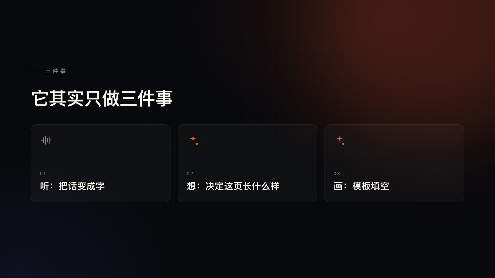

# Live Deck · 边讲边长的幻灯片

[English](README.en.md) · 中文

你说话，画面自己长出来。

本地流式转写 → 一个很小的语言模型当场决定"这句话该长什么样" → 模板立刻画出来；你继续说，这一页就继续被改准。不用先写完稿、不用先生成 20 页再翻。

> Talk, and the slide grows with you. Local speech-to-text, a tiny LLM as a live "visual director",
> and a template renderer — no slide generation step, no waiting for the sentence to end.


---

## 它解决什么问题

做口播、直播、内训的人都有同一个麻烦：**内容是讲出来的，但画面是事先排好的**。要么提前花三四个小时做 PPT，要么边讲边翻一堆对不上的页。

Live Deck 把顺序反过来：你先讲，画面跟着讲的内容走。

- 讲到"从三小时到一分钟"，屏幕上就出现左右对照。
- 讲到三个并列的点，屏幕上就出现三张卡片，一张一张蹦出来。
- 讲到"关键是节奏"，屏幕上就是一句大字，背后一个淡符号。
- 讲错了、绕回去了，画面不会突然跳走——同一句话内的所有更新都是原地改写。

关键字：**一页一页长出来，而不是一次性生成；延迟藏在"你还在说话"的那一秒里。**

| | |
| --- | --- |
|  |  |
|  |  |

## 跑起来

```bash
git clone https://github.com/wwq0327/live-deck && cd live-deck
node server.mjs            # 打开 http://127.0.0.1:4400
```

前端零依赖、零构建，`node` 直接用。转写要一个 Python 环境和模型，见下面的「准备模型」。


打开页面后：

| 操作 | 效果 |
| --- | --- |
| 点「麦克风」（或按 `m`） | 允许权限后开始听，说完一句停一下，页面就出来 |
| 输入框打字 + 回车 | 不用麦克风也能试，一句一页 |
| 点「演示」（或按 `d`） | 跑一段 40 秒预置口播稿 |
| 把 `.wav` 拖进页面 | 回放一段录音，走完全相同的管线 |
| `f` / `h` / `r` | 全屏 / 隐藏所有 UI / 重置 |

### 准备模型（二选一）

**A. SenseVoice（推荐，50–140ms/句）**

```bash
python3 -m venv .venv
.venv/bin/pip install -r requirements.txt      # sherpa-onnx + numpy
```

把 sherpa-onnx 版的 SenseVoice int8 放到 `./models/sensevoice-onnx/`：

```
models/sensevoice-onnx/model.int8.onnx     约 239MB
models/sensevoice-onnx/tokens.txt
```

模型目录也可以用 `SENSEVOICE_DIR` 指向别处。找不到模型时服务会直接告诉你缺什么。

**B. whisper（慢 5–10 倍，但更准）**

```bash
pip install openai-whisper          # 或者用系统里的 whisper
ASR_BACKEND=whisper ASR_MODEL=small node server.mjs
```

如果 partial 的 100–300ms 也会挡住收句，可以再开一个只接 final 的 worker：

```bash
ASR_FINAL_WORKER=1 node server.mjs
```

实测 20 秒 partial 正在跑时再发 10 秒 final：final 从 442ms 降到 159ms。代价是再加载一份模型（SenseVoice 约 239MB），内存翻倍；默认关闭。

**导演模型**需要一个 DeepSeek Key：先读环境变量 `DEEPSEEK_API_KEY`，没有就读 `~/.dsh/.credentials.yaml`。
没有 Key 也能跑——自动降级成本地关键词规则，出页变笨但不会挂。

## 实测延迟（M 系列 Mac）

| 环节 | SenseVoice | whisper-small |
| --- | --- | --- |
| 转写一句 3–8 秒的话 | **0.05 – 0.14s** | 0.55 – 0.92s |
| 导演决策（关掉思考链） | 0.8 – 1.3s | 0.8 – 1.3s |
| **从开口到第一页** | **约 1.5s（你还在说的时候就出了）** | 约 2.5s |
| **从闭嘴到定稿** | **0.0 – 0.4s** | 1.6 – 2.0s |

打字路径：一句 → 页面 0.7–1.0s（省掉转写）。

## 怎么做到的

```
麦克风 ──► AudioWorklet（16k PCM）──► 能量 VAD 切句
                                        │ partial 每 0.7s ─┐
                                        │ final   收句     │
                                        ▼                  ▼
                             本地 SenseVoice 常驻进程（模型只加载一次）
                                        │
                                        ▼
                          POST /api/direct ──► 小模型（JSON 指令）
                                        │           ├─ 现在这页：new_slide / patch / noop
                                        ▼           └─ 下一句讲什么：predict
                              模板渲染（13 构图 × 3 底色，纯 DOM）
```

四条关键设计，缺一条就"不像实时"：

1. **不等你说完**。部分转写一到就先上一页占位，模型结果回来**原地改写**，不翻页。收句只是定稿。
2. **不生成、只填空**。模型输出一条 JSON 指令（用哪种构图、写什么字），渲染是纯 DOM 模板，不到 50ms。
3. **关掉思考链**。同一个模型，开着思考 1.9–2.6s，关掉 0.6–1.0s。这一条值 1.5 秒。
4. **一页别翻两次**。句子有编号，上一句迟到的预判结果直接丢弃；标题相同的下一页就地改写。

细节在 [`docs/architecture.md`](docs/architecture.md)。

## 文档

| 文档 | 内容 |
| --- | --- |
| [docs/architecture.md](docs/architecture.md) | 数据流、时序、状态机、竞态处理、延迟预算 |
| [docs/director.md](docs/director.md) | 导演协议：JSON schema、提示词全文、调优记录、换模型 |
| [docs/layouts.md](docs/layouts.md) | 13 种构图 × 3 种底色、选择规则、加一种新版式 |
| [docs/troubleshooting.md](docs/troubleshooting.md) | 起不来、没声音、延迟异常、日志怎么读 |
| [docs/roadmap.md](docs/roadmap.md) | 已知限制、下一步、发布前的待办 |

## 目录

```
server.mjs          本地 HTTP 服务：静态舞台 + /api/direct + /api/asr
director.mjs        导演：提示词、调用、JSON 校验与兜底
asr.mjs             ASR 常驻进程的管理器（优先级队列、超时、重启）
asr_worker.py       转写进程（SenseVoice / whisper 双后端，stdin/stdout JSON 行协议）
public/             零构建前端
  index.html
  stage.css         三种底色 + 十三种构图
  stage.js          音频采集、VAD、状态机、模板渲染
  pcm-worklet.js    AudioWorklet：把 PCM 攒成 2048 帧一包
  sample.wav        拖拽回放用的样例录音
docs/               文档与截图
```

## 已知限制

- 收句靠**能量阈值**，不是 VAD 模型；环境很吵时会切碎。
- 中文**同音错字**（"一份"→"一粉"、"PPT"→"TTT"），拉丁词有正则修正，汉字靠导演提示词按上下文改。
- 没有**回退**：说错了只会继续往下走，不会撤回上一页。
- 底色节奏（大约每四页一张米白）是写死的。
- 只做了中文口播的场景；英文能跑但断句和排版没调过。

完整清单和计划见 [`docs/roadmap.md`](docs/roadmap.md)。

## 许可

[MIT](LICENSE) © 2026 walt

随便用、随便改、随便商用，保留版权声明就行。
