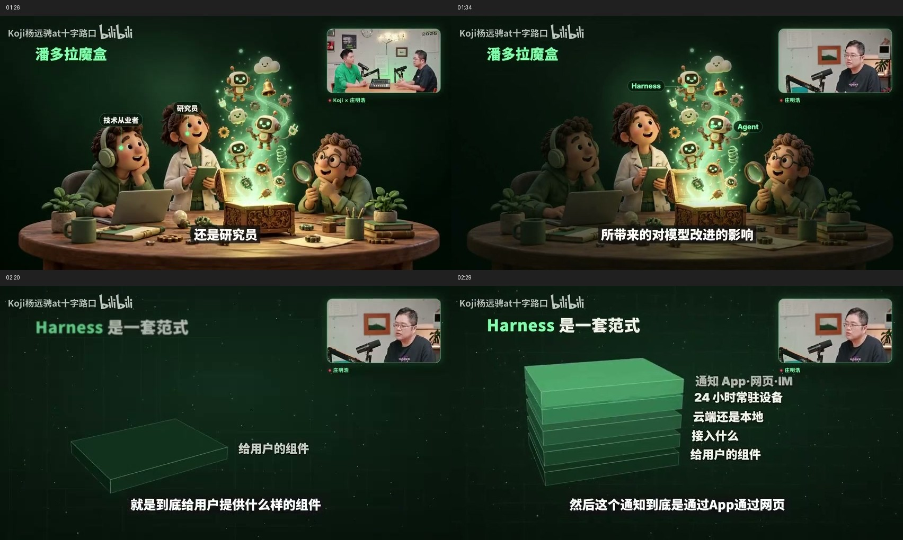

# 参考视频拆解：让画面随讲述逐步展开

日期：2026-11-07。范围：视觉与实现路径研究；未修改应用代码，也未测试新的生成方案。

参考：[十字路口：AI 带给我的 10 个 Aha Moments](https://www.bilibili.com/video/BV1nAxs6BEP5/)。重点抽查 00:36—03:36 约三分钟，另看开场视觉；依据视频帧、画面内字幕与页面简介，关键段落按一秒间隔复查。没有分析完整节目、原工程或制作后台。

## 结论与证据边界

值得借鉴的核心是：**保持一个稳定场景，根据讲述增添元素、突出当前重点，再在内容转折时换场景。** 换页速度只是其中一部分。

成片能证明画面与讲述同步、元素逐步出现，不能证明这些元素是在录制现场实时生成。查看到的简介未披露制作管线；本次也未获得作者的技术说明。以下“可实现方式”是针对本项目的建议，不代表作者实际采用的方法。

插画具有统一的三维卡通风格，但仅凭画面不能确认它们是否由 AI 生成、用了什么模型，或是否经过人工加工。堆叠图等几何画面也不必用图像模型制作。

## 观察到的共性

| 部分 | 可见证据 | 对项目的启发 |
| --- | --- | --- |
| 底色 | 抽查的图文场景反复使用深绿色背景，带微弱网格、颗粒及光感 | 固定主题底板；减少不必要的换色 |
| 文字 | 白字为主，绿色强调概念；标题、图内标签、底部字幕各有位置 | 分开处理提炼后的画面信息与逐句字幕 |
| 图片 | 排队场景、围桌插画、人物形象、泡泡等承担具体比喻 | 需要能表达内容的插画素材，内置小图标不足以替代 |
| 结构图 | 台阶、堆叠、趋势线把等级、组成、变化变成空间关系 | 用 SVG／DOM 组件表达关系，保持文字可独立更新 |
| 更新 | 同一图上的标签、亮度及图层随讲话变化 | 将“增添一个对象”和“切换整页”分为两种操作 |
| 节奏 | 并非每句话都出新画面，部分图文场景持续十几秒以上 | 以完整观点或比喻作为场景单位 |

人物素材不在本次实现建议范围内；仅在分析构图时注意右上角视频窗占用的区域。

## 关键时间点

时间为原视频时间，可在播放器中定位。截图仅用于这次研究，保留原视频水印。

| 时间 | 实际观察 | 可采用的实现方式（建议） |
| --- | --- | --- |
| 约 01:05 | 排队主题插画配简短标题，仍使用统一绿底 | 插画作为独立素材，底板与文字独立渲染 |
| 约 01:22—01:40 | 围桌插画持续存在；人物标注依次增加，随后旁侧区域变暗，中央发光部分成为焦点 | 复用同一素材，增加标签层与局部遮罩；不必反复重新生成整图 |
| 约 02:05 | 等级被画成递增台阶 | SVG 或 CSS 图形组件；这里的高度表达等级，不是统计量 |
| 约 02:20—02:39 | 堆叠图从单层逐步增加到五层，右侧标签随字幕所说的组成部分逐项补充 | 保持场景和已有图层，收到新信息后新增一层，完成局部动画 |
| 约 03:05—03:15 | 下降趋势图承载口述数量级，之后增加补充标记 | 按口述的概数画示意图；保留“几万／几千”等不确定性，不包装成精确数据 |
| 约 03:25—03:35 | 泡泡意象周围逐渐增加情绪标签与提问文字 | 保留主体，逐项加入标注；主题变化后再换场景 |



单帧：[排队插画](01-05-illustration.jpg) · [人物标注](01-26-labels.jpg) · [焦点变化](01-34-focus.jpg) · [台阶图](02-05-stairs.jpg) · [堆叠起始](02-20-stack-start.jpg) · [堆叠展开](02-29-stack-expanded.jpg) · [趋势图](03-05-trend.jpg)。

## 与当前项目的差距

以下根据当前代码静态检查，不以 README 中的历史延迟描述作为本次性能实测。

| 能力 | 当前代码 | 与参考效果的差距 |
| --- | --- | --- |
| 语音驱动画面 | 已有转写、导演决策、预览及定稿链路 | 基础方向成立，本次没有重新验证运行表现 |
| 场景持续性 | `director.mjs` 的规则鼓励新信息出页，新例子、转折或数字触发新页 | 容易把一个逐步展开的解释拆碎 |
| 局部更新 | `patch` 主要通过 `add_points` 追加列表；`morph()` 会重写整页 `innerHTML` | 缺少独立图形对象及身份，难以只增加一层、只高亮某对象 |
| 版式与底色 | `derive()` 有避免连续同版式、按页数交替底色的规则 | 需要允许同一主题长时间保持相同构图与底色 |
| 图片 | 主要是内置 SVG 符号 | 缺少插画素材的获取、缓存、定位与复用能力 |
| 关系表达 | 有数字、对比、步骤等模板 | 缺少可逐步扩展的堆叠、台阶、趋势与图片标注场景 |

相关代码：[导演](../../../director.mjs)、[前端状态及渲染](../../../public/stage.js)、[舞台样式](../../../public/stage.css)。

## 建议的实现路径

整体保留现有 Node.js 与浏览器渲染方式。将导演的任务从“这一句用哪张幻灯片”扩展为“当前场景需要发生什么变化”。

```text
语音 → 转写 → 判断当前观点是否继续
                  ├─ 继续：加标签／加图层／高亮／改文字／保持不动
                  └─ 转折：新建场景
                              ↓
                  校验指令 → 更新场景对象 → 局部动画

配图支路：主题或已确认语义 → 获取／生成素材 → 缓存
                                          ↓
                             场景仍匹配时再接入
```

场景应有稳定的 `scene_id`，图形和标签有 `element_id`。模型输出有限操作，例如 `create_scene`、`append_layer`、`add_label`、`focus`、`update_text`、`hold`。渲染器校验后执行，不要求模型每句话重新生成 HTML。

已有 `morph()` 可以继续服务草稿定稿；结构图应保留已存在的 DOM／SVG 对象，只对新增或变化的对象播放动画。语音识别的片段边界也不应直接等同于场景边界。

图片宜异步准备：有素材就复用，没有就先用简单图形表达；素材回来时校验场景标识与版本，过期结果丢弃。若有节目主题或提纲，可提前准备风格一致的素材库；完全即兴的首次配图需要接受等待或占位。此处没有测试图片服务、速度或成本。

**提前生成的是素材，讲话时决定的是显示什么、放哪里、补什么。** 即便采用这种混合方式，也能实现用户想要的随口播展开的观感；若要求每张插画都现场生成，则是另一个更严格的延迟目标。

## 优先顺序与验证标准

1. 先做同场景的增量更新，选“逐层堆叠”和“图片加标注”两个代表场景。
2. 用一段约 30 秒的固定讲述检查：连续补充信息时不换页，已有对象不消失、不重复播放入场；识别纠错能更正对应文字。
3. 再验证真实话题转折能新建场景，迟到的素材或导演结果不会覆盖新场景。
4. 最后接动态配图，记录首个可用画面耗时、配图到达耗时，以及错配或过期比例。

这能先验证参考视频最有价值的共性，避免把“图像生成更快”误当成全部问题。下一阶段是否开发、采用预备素材还是完全即兴配图，尚未由本次研究决定。
